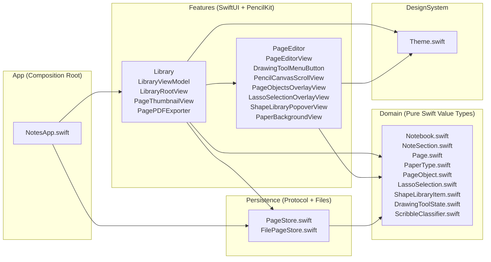

# Notes — Native iPadOS Handwriting & Structured Notes (`v1b`)

> **"Notion with Apple Pencil"** — A native iPadOS handwriting, diagrams, and structured notes application built exclusively with SwiftUI, PencilKit, and UIKit. Zero third-party dependencies.

📄 **[Milestone v1b Technical & Architecture Guide (PDF)](docs/Notes-v1b-Documentation.pdf)** · 📄 **[Milestone v1a Guide (PDF)](docs/Notes-v1a-Documentation.pdf)** · 🏛️ **[Architecture Map (`docs/ARCHITECTURE.md`)](docs/ARCHITECTURE.md)** · 🗺️ **[Product Specification & Roadmap (`SPEC.md`)](SPEC.md)**

---

## ✨ What's New in Milestone `v1b` (Objects, Lasso & Shape Library)

Milestone `v1b` expands handwritten notes into a full diagramming and visual thinking platform:

- **Interactive PageObjects (Basic Shapes & Photos)**
  - **Basic Shapes**: Insert crisp vector **Rectangle**, **Circle**, **Arrow**, and **Line** objects with thickness and 8 ink color presets.
  - **Photos & Images**: Insert images via Photos Picker (`PhotosUI`), saved as normalized PNG assets in `Assets/<asset-uuid>.dat` without inflating notebook JSON metadata.
  - **Unified Handle System**:
    - **Rectangles, Circles, Images & Placed Shapes**: 4 circular corner handles (minimum 44 pt touch target) that pin the diagonally opposite corner during resizing, a dashed border for live moving/translation, and a top rotation stalk for 360-degree freeform rotation.
    - **Lines and Arrows**: Blueprint-inspired **two end-bar handles** that stretch or shrink the line in either direction while pinning the opposing endpoint, paired with a central rotation handle.
    - **Auto-Deselect**: Tap anywhere on the page to deselect objects; no cluttering pointer tool button needed.
- **Freehand Lasso Selection Tool**
  - Toggle the **Lasso** tool in the toolbar to draw a freehand loop around handwriting strokes and PageObjects.
  - **Ray-Casting Jordan Curve Point-in-Polygon Engine**: Evaluates ink stroke points ($\ge 60\%$ enclosure threshold) and object centers using pure geometric ray-casting.
  - **Real-Time Translation**: Dragging inside the lasso boundary translates both ink strokes and PageObjects in real time.
  - **Floating Action Menu**:
    - **Recolour**: Apply any of the 8 ink color swatches to all enclosed handwriting strokes simultaneously.
    - **Duplicate**: Clones selection with a 24 pt offset.
    - **Convert to Object**: Freezes selected ink strokes into an interactive, rotatable `.strokeGroup` `PageObject`.
    - **Copy & Cut**: Places strokes and objects onto the clipboard.
    - **Delete**: Cleans up enclosed strokes and objects in one action.
- **Cross-Notebook Clipboard Copy & Paste**
  - Copy ink strokes, shapes, and images from one page and paste them onto any other page in the same notebook or across different notebooks.
  - Generates independent `UUID` identities and duplicate image assets so copied objects can be moved and edited independently without side-effects.
- **Notebook Shape Library (Reusable Diagram Shapes)**
  - Lasso any drawing and tap **Save to Library** (`square.and.arrow.down`) with a custom name.
  - Generates transparent-background thumbnail preview cards using `PKDrawing.image(from:scale:)`.
  - Accessible via the **Shape Library** toolbar button (`square.stack.3d.up`):
    - Displays all saved shapes for the current notebook.
    - Tap the notebook title at the top of the popover to browse and borrow diagram shapes from **any other notebook**.
    - Tap any card to place it centered onto the active page as an interactive, resizable, and rotatable `.strokeGroup` `PageObject`.
    - Long-press any shape to delete it from the library.

---

## 🏛️ What Was Built in Milestone `v1a` (Working Notebook)

- **3-Level Permanent-UUID Hierarchy (`Notebook` → `NoteSection` → `Page`)**
  - Create, rename, reorder, and delete notebooks, sections, and pages.
  - Permanent `UUID` identity on every entity (never keyed by title or array index).
  - Live `PKDrawing` page thumbnails in the sidebar, plus single-page and multi-page batch operations (**Share PDF**, **Move to Section**, **Delete**).
- **A4 Portrait Paper & PencilKit Canvas (`595 × 842 pt`)**
  - True A4 portrait page geometry with `.lined` ($28\text{ pt}$ rule + left margin), `.squared` ($24\text{ pt}$ grid), and `.blank` paper backgrounds rendered behind the ink layer (`PaperBackgroundView`)—never drawn into ink data.
  - Smooth `0.5× – 4.0×` pinch-to-zoom inside a custom `UIScrollView` (`PencilCanvasScrollView`) with magnetic $\pm 8\%$ snap-to-fit-width and snap-to-whole-page.
  - Deliberate horizontal edge-swipe turns to previous/next page—or creates a new page when swiping left past the last page (`0.42s` push transition).
- **Custom 4-Tool Popover Menu & Apple Pencil Ergonomics**
  - **Pen (Ballpoint `.monoline`)**: Constant stroke width regardless of Apple Pencil tilt or pressure; 6 colour presets (explicit Black, White, Blue, Red, Green, Orange), 3 stroke widths (`1.5`, `3.0`, `5.5 pt`), and 3 opacity presets (`40%`, `75%`, `100%`).
  - **Highlighter (`.marker`)**: Chisel-tip marker with 6 colour presets, 3 widths (`12`, `20`, `30 pt`), and 3 opacity presets (`25%`, `45%`, `70%`).
  - **Rubber (`.eraser`)**: Switchable between **Object (Stroke) Eraser** (`.vector`) and **Pixel Eraser** (`.bitmap`).
  - **Ruler Toggle**: Native PencilKit ruler overlay scaled to `75%` for comfortable iPad proportions.
  - **Apple Pencil Double-Tap**: Hardware `UIPencilInteraction` toggles directly between the active inking tool and Rubber.
  - **Explicit Light Canvas Ink Rendering**: `canvasView.overrideUserInterfaceStyle = .light` guarantees that Black ink stays black and White ink stays white regardless of system Dark Mode.
- **Geometric Scribble-to-Erase (`ScribbleClassifier`)**
  - Pure-Swift geometric classifier (`Domain/ScribbleClassifier.swift`) that inspects newly drawn strokes for high direction-reversal density ($\ge 3$ sharp reversals at $\ge 115^\circ$), compact aspect ratio, and bounding-box coverage over prior strokes.
  - Automatically removes the scribble and intersecting strokes as a **single Undo step** (`UndoManager`).
- **Atomic Persistence & Vector A4 PDF Export**
  - **Separated Metadata & Ink**: `FilePageStore` writes `notebooks.json` atomically alongside per-page `Drawings/<page-uuid>.pkdrawing` binary files.
  - **400ms Debounced Autosave + Lifecycle Flush**: Saves automatically after each stroke and flushes immediately on page switch or backgrounding.
  - **Vector PDF Export (`PagePDFExporter`)**: Renders single pages, selected page subsets, or entire sections to multi-page $595 \times 842\text{ pt}$ A4 PDFs combining paper background, `PKDrawing`, and `PageObjects`.

---

## 🏗️ Architecture & Dependency Direction

The codebase enforces a strict unidirectional dependency rule so business logic and persistence are unit-tested without UIKit or simulator dependencies:



**Dependency Rule:** `Domain` ← `Persistence` ← `Features` ← `App`. `Domain` imports only `Foundation` and `CoreGraphics`.

---

## 📂 Codebase Map ("What is What")

```text
Notes/
├── App/
│   └── NotesApp.swift                  # Entry point & composition root; injects FilePageStore and flushes saves on backgrounding
├── Domain/
│   ├── Notebook.swift                  # Top-level Notebook aggregate (UUID, title, timestamps, defaultPaperType, [NoteSection])
│   ├── NoteSection.swift               # Section value type + page CRUD, insertion after active page, batch delete & reorder
│   ├── Page.swift                      # Page metadata value type (UUID, title, PaperType, [PageObject], timestamps)
│   ├── PageObject.swift                # PageObject (frame, rotation, kind: basicShape, image, strokeGroup), resize math & hit-testing
│   ├── LassoSelection.swift            # LassoPolygon ray-casting point-in-polygon math, ActiveLassoSelection & Clipboard payload
│   ├── ShapeLibraryItem.swift          # ShapeLibraryItem model (UUID, notebookID, label, strokeDrawingData, dimensions)
│   ├── PaperType.swift                 # PaperType (.lined, .squared, .blank) + PageGeometry (595×842 pt A4 & zoom-snap math)
│   ├── DrawingToolState.swift          # Pure state for Pen/Highlighter/Rubber/Ruler, colour/size/opacity presets & Pencil double-tap
│   └── ScribbleClassifier.swift        # Pure geometric stroke classifier for Scribble-to-Erase + CGRect intersection helpers
├── Persistence/
│   ├── PageStore.swift                 # Persistence boundary protocol + PageStoreError
│   └── FilePageStore.swift             # Atomic file store:
│                                       #   - notebooks.json
│                                       #   - Drawings/<uuid>.pkdrawing
│                                       #   - Assets/<uuid>.dat
│                                       #   - ShapeLibrary/<notebook-uuid>.json
│                                       #   - ShapeLibrary/Previews/<item-uuid>.png
├── Features/
│   ├── Library/
│   │   ├── LibraryViewModel.swift      # @Observable coordinator: CRUD, PageObjects, Lasso, Clipboard, Shape Library, autosave
│   │   ├── LibraryRootView.swift       # 3-column NavigationSplitView, multi-page selection bar, rename/move sheets & error alerts
│   │   ├── PageThumbnailView.swift     # Miniature A4 page card rendering paper background + scaled PKDrawing preview
│   │   └── PagePDFExporter.swift       # Multi-page A4 vector PDF exporter rendering paper + ink + PageObjects
│   └── PageEditor/
│       ├── PageEditorView.swift        # Page editor toolbar (Full-Screen, Undo/Redo, Tool Menu, Lasso, Insert, Shape Library)
│       ├── PencilCanvasScrollView.swift# UIKit UIScrollView + PKCanvasView (.monoline ballpoint, 0.75x ruler, scribble erase)
│       ├── PageObjectsOverlayView.swift# Interactive overlay handles (corner resize, rotate, linear end-bars, translation)
│       ├── LassoSelectionOverlayView.swift # Freehand lasso loop tracing, translation & floating action toolbar
│       ├── ShapeLibraryPopoverView.swift # Reusable diagram shapes popover with cross-notebook browsing drawer
│       ├── DrawingToolMenuButton.swift # 4-Tool menu button & popover (Pen >, Highlighter >, Rubber >, Ruler)
│       └── PaperBackgroundView.swift   # Vector canvas drawing lined/squared/blank paper behind ink
└── DesignSystem/
    └── Theme.swift                     # Centralized colour palette (8 presets), spacing, corner radii, and stroke widths
```

---

## 🧪 Automated Test Suite (31 Tests Passing)

All business logic, geometric algorithms, and file persistence are covered by automated unit tests:

| Test Suite | File | Tests | Coverage |
| :--- | :--- | :---: | :--- |
| **`PageObjectTests`** | `NotesTests/Domain/PageObjectTests.swift` | 5 | Move/resize anchoring opposite corner, rotation, line end-bars, backward-compatible v1a JSON decoding |
| **`LassoSelectionTests`** | `NotesTests/Domain/LassoSelectionTests.swift` | 2 | Ray-casting point-in-polygon math, sample threshold enclosure, object center detection, tap rejection |
| **`FilePageStoreTests`** | `NotesTests/Persistence/FilePageStoreTests.swift` | 6 | Notebook round-trip, drawing separation, asset storage lifecycle, shape library persistence & previews |
| **`LibraryViewModelTests`**| `NotesTests/Features/LibraryViewModelTests.swift` | 9 | PageObject lifecycle, cross-notebook copy/paste, shape library CRUD, autosave debounce, batch move |
| **`ScribbleClassifierTests`**| `NotesTests/Domain/ScribbleClassifierTests.swift` | 6 | Synthetic scribble over strokes, straight lines, circles, zigzag letters, overlap ratio, toggle |
| **`NotebookHierarchyTests`** | `NotesTests/Domain/NotebookHierarchyTests.swift` | 3 | UUID permanence across reordering, paper inheritance/overrides, title sanitization |

### Running the Tests
```bash
xcodebuild test -project Notes.xcodeproj -scheme Notes -destination 'platform=iOS Simulator,name=iPad Pro 13-inch (M5)'
```

---

## 🗺️ Product Roadmap

- [x] **Milestone `v1a` — Working Notebook**: Hierarchy, paper backgrounds, ballpoint ink, scribble-to-erase, thumbnails, debounced autosave, vector PDF export.
- [x] **Milestone `v1b` — Objects and Library**: Basic shapes, images, freehand lasso, cross-notebook copy & paste, notebook shape library.
- [ ] **Milestone `v1c` — Structure**: Set grid tables with freehand handwriting in cells + Page-to-Page permanent links (`[[page]]`).
- [ ] **Milestone `v2`**: Typed text boxes, collapsible headings navigation, hidden handwriting transcript per page.
- [ ] **Milestone `v3`**: Live iPad-to-web sync & web viewer.
- [ ] **Milestone `v4`**: Direct AI notes analysis with transcript & diagram vision context.
