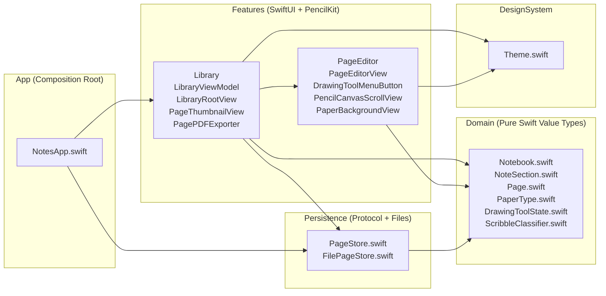

# Notes — Native iPadOS Handwriting & Structured Notes (`v1a`)

> **"Notion with Apple Pencil"** — A native iPadOS handwriting, diagrams, and structured notes application built exclusively with SwiftUI, PencilKit, and UIKit. Zero third-party dependencies.

📄 **[Full v1a Technical & Architecture Documentation (PDF)](docs/Notes-v1a-Documentation.pdf)** · 🏛️ **[Architecture Map (`docs/ARCHITECTURE.md`)](docs/ARCHITECTURE.md)** · 🗺️ **[Product Specification & Roadmap (`SPEC.md`)](SPEC.md)**

---

## ✨ What's in Milestone `v1a` (Working Notebook)

Milestone `v1a` delivers a complete, daily-usable handwritten notebook experience on iPad:

- **3-Level Permanent-UUID Hierarchy (`Notebook` → `NoteSection` → `Page`)**
  - Create, rename, reorder, and delete notebooks, sections, and pages.
  - Permanent `UUID` identity on every entity (never keyed by title or array index) so future cross-page links (`[[page]]`) and iCloud/Mac sync never break.
  - Live `PKDrawing` page thumbnails in the sidebar, plus single-page and multi-page batch operations (**Share PDF**, **Move to Section**, **Delete**).
- **A4 Portrait Paper & PencilKit Canvas (`595 × 842 pt`)**
  - True A4 portrait page geometry with `.lined` ($28\text{ pt}$ rule + left margin), `.squared` ($24\text{ pt}$ grid), and `.blank` paper backgrounds rendered behind the ink layer (`PaperBackgroundView`)—never baked into the drawing data.
  - Smooth `0.5× – 4.0×` pinch-to-zoom inside a custom `UIScrollView` (`PencilCanvasScrollView`) with magnetic $\pm 8\%$ snap-to-fit-width (`fitWidthZoomScale`) and snap-to-whole-page (`fitWholePageZoomScale`), plus sharp vector re-rasterisation of the paper layer after zoom ends.
  - Deliberate horizontal swipe at the left/right scroll edge turns to the previous/next page—or creates a new page when swiping left past the final page—with a directional push transition (`0.42s`).
- **Custom 4-Tool Popover Menu & Apple Pencil Ergonomics**
  - **Pen (Ballpoint `.monoline`)**: Constant stroke width regardless of Apple Pencil tilt or pressure; 6 colour presets (explicit Black, White, Blue, Red, Green, Orange), 3 stroke widths (`1.5`, `3.0`, `5.5 pt`), and 3 opacity presets (`40%`, `75%`, `100%`).
  - **Highlighter (`.marker`)**: Chisel-tip marker with 6 colour presets, 3 widths (`12`, `20`, `30 pt`), and 3 opacity presets (`25%`, `45%`, `70%`).
  - **Rubber (`.eraser`)**: Switchable between **Object (Stroke) Eraser** (`.vector`) and **Pixel Eraser** (`.bitmap`).
  - **Ruler Toggle**: Native PencilKit ruler overlay scaled to `75%` for comfortable iPad screen proportions and preserved across pinch-zoom interactions.
  - **Apple Pencil Double-Tap**: Hardware `UIPencilInteraction` toggles directly between the active inking tool and the Rubber eraser.
  - **Explicit Light Canvas Ink Rendering**: `canvasView.overrideUserInterfaceStyle = .light` guarantees that Black ink stays black and White ink stays white regardless of system Dark Mode.
- **Geometric Scribble-to-Erase (`ScribbleClassifier`)**
  - Pure-Swift geometric classifier (`Domain/ScribbleClassifier.swift`) that inspects newly drawn strokes for high direction-reversal density ($\ge 3$ sharp reversals at $\ge 115^\circ$), compact aspect ratio, and bounding-box coverage over prior strokes.
  - Automatically removes the scribble and intersecting strokes as a **single Undo step** (`UndoManager`), and can be toggled on/off in the editor toolbar.
- **Atomic Persistence & Vector A4 PDF Export**
  - **Separated Metadata & Ink**: `FilePageStore` writes `notebooks.json` atomically alongside per-page `Drawings/<page-uuid>.pkdrawing` binary files.
  - **400ms Debounced Autosave + Lifecycle Flush**: Saves automatically after each stroke and flushes immediately on page switch or when the app enters the background (`scenePhase != .active`).
  - **Vector PDF Export (`PagePDFExporter`)**: Renders single pages, selected page subsets, or entire sections to multi-page $595 \times 842\text{ pt}$ A4 PDFs combining the paper template and `PKDrawing`.

---

## 🏗️ Architecture & Dependency Direction

The codebase enforces a strict one-way dependency rule so business logic and persistence can be unit-tested without UIKit or the simulator:



**Dependency Rule:** `Domain` ← `Persistence` ← `Features` ← `App` (with `DesignSystem` shared by `Features`). `Domain` imports only `Foundation` and `CoreGraphics`.

---

## 📂 Codebase Map ("What is What")

```text
Notes/
├── App/
│   └── NotesApp.swift                  # Entry point & composition root; injects FilePageStore and flushes saves on backgrounding
├── Domain/
│   ├── Notebook.swift                  # Top-level Notebook value type (UUID, title, timestamps, [NoteSection])
│   ├── NoteSection.swift               # Section value type + page CRUD, insertion after active page, batch delete & reorder
│   ├── Page.swift                      # Page metadata value type (UUID, title, PaperType, timestamps) — no ink bytes in memory
│   ├── PaperType.swift                 # PaperType (.lined, .squared, .blank) + PageGeometry (595×842 pt A4 & zoom-snap math)
│   ├── DrawingToolState.swift          # Pure state for Pen/Highlighter/Rubber/Ruler, colour/size/opacity presets & Pencil double-tap
│   └── ScribbleClassifier.swift        # Pure geometric stroke classifier for Scribble-to-Erase + CGRect intersection helpers
├── Persistence/
│   ├── PageStore.swift                 # Async persistence boundary protocol + localized PageStoreError
│   └── FilePageStore.swift             # Actor-isolated atomic file store (notebooks.json + Drawings/<uuid>.pkdrawing)
├── Features/
│   ├── Library/
│   │   ├── LibraryViewModel.swift      # @Observable @MainActor coordinator: selection, CRUD, 400ms debounced autosave, page turning
│   │   ├── LibraryRootView.swift       # 3-column NavigationSplitView, multi-page selection bar, rename/move sheets & error alerts
│   │   ├── PageThumbnailView.swift     # Miniature A4 page card rendering paper background + scaled PKDrawing preview
│   │   └── PagePDFExporter.swift       # UIGraphicsPDFRenderer vector A4 PDF generator for 1 or N pages
│   └── PageEditor/
│       ├── PageEditorView.swift        # Detail toolbar: Full-Screen toggle, Undo/Redo, 4-Tool menu, Scribble toggle, Paper picker
│       ├── DrawingToolMenuButton.swift # Compact 4-row popover (Pen, Highlighter, Rubber, Ruler) with hover/tap flyout submenus
│       ├── PencilCanvasScrollView.swift# UIKit UIScrollView + PKCanvasView wrapper: zoom, centering, ruler, swipe page turn, scribble erase
│       └── PaperBackgroundView.swift   # SwiftUI Canvas rendering lined, squared, and blank A4 paper behind PKCanvasView
├── DesignSystem/
│   └── Theme.swift                     # Centralised paper colours, line/grid spacings, zoom limits, and toolbar metrics
└── NotesTests/
    ├── NotebookHierarchyTests.swift    # 6 tests: UUID stability, page insertion order, batch delete, reordering & zoom snap math
    ├── ScribbleClassifierTests.swift   # 6 tests: synthetic dense scribble, straight line, circle, zigzag letter, disabled toggle
    ├── DrawingToolStateTests.swift     # 3 tests: tool selection, size/opacity clamping, Pencil double-tap eraser swap
    ├── FilePageStoreTests.swift        # 4 tests: round-trip save/load, drawing persistence, deletion cleanup, corrupt JSON error
    └── LibraryViewModelTests.swift     # 6 tests: initial seeding, stroke save & reload, swipe-to-next/new page, error surfacing
```

---

## 🛠️ Building & Running Tests

### Requirements
- **Xcode 16.0+** (tested with iPadOS 18.0+ / 26.2 SDK)
- **iPad Simulator** or physical **iPad with Apple Pencil**

### Build (Simulator)
```bash
xcodebuild -project Notes.xcodeproj \
  -scheme Notes \
  -destination 'platform=iOS Simulator,name=iPad Pro 13-inch (M5)' \
  build
```

### Run Full Unit Test Suite (25 Tests)
```bash
xcodebuild -project Notes.xcodeproj \
  -scheme Notes \
  -destination 'platform=iOS Simulator,name=iPad Pro 13-inch (M5)' \
  test
```

### Regenerate the PDF Technical Documentation
The `docs/Notes-v1a-Documentation.pdf` document is generated programmatically using CoreGraphics/AppKit so diagrams and documentation stay reproducible:
```bash
swift docs/generate_v1a_pdf.swift docs/Notes-v1a-Documentation.pdf
```

---

## 🗺️ Roadmap

| Milestone | Focus | Status |
| :--- | :--- | :--- |
| **`v1a`** | **Working Notebook** — Notebook/Section/Page hierarchy, A4 paper templates, custom 4-tool PencilKit menu, Scribble-to-Erase, zoom snap, swipe page turn, atomic persistence, vector PDF export | ✅ **Released** |
| **`v1b`** | **Structured Content** — Typed text boxes, headings (`H1`/`H2`/`H3`) with auto-outline, tables, shape snap & shape library, image insertion, `[[Page Links]]` + backlinks | ⏳ Planned |
| **`v2`** | **Mac Companion & Sync** — iCloud (`CloudKit` / iCloud Drive) sync + read/write macOS viewer | ⏳ Planned |
| **`v3`** | **Research Workspace** — Split-screen web viewer, web clipping to canvas, audio/video lecture transcript side-by-side | ⏳ Planned |
| **`v4`** | **Local AI Assistant** — On-device handwriting OCR search, selection explain/summarise, transcript Q&A | ⏳ Planned |
